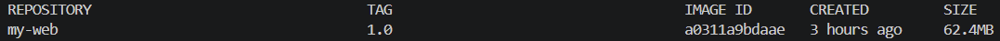
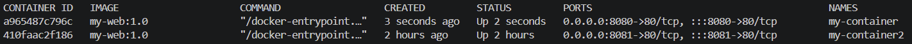

# E1-1. Dev Setup

## 1) Environment

| 항목 | 버전 |
| --- | --- |
| OS | Ubuntu 20.04.6 LTS |
| Shell | Bash 5.0.17(1)-release |
| Docker | 23.0.3 |
| Git | 2.25.1 |

## 2) Checklist

- [X] (1) Terminal & Folder - Basic terminal operations and folder setup
- [X] (2) Permission - Practice changing file permissions
- [X] (3) Docker Installation - Install and verify Docker
- [X] (4) Docker Build / Execution - Build and run a Docker image using a Dockerfile
- [X] (5) "hello-world" Execution - Run the hello-world container
- [X] (6) Port Mapping & Access - Access containers through port mapping (2 times)
- [X] (7) Bind Mount - Verify bind mount synchronization
- [X] (8) Volume - Verify Docker volume persistence
- [X] (9) Git & VSCode Github - Configure Git and connect VS Code to GitHub

## 3) Details

- [0. Version Check](#step-0)
- [1. Terminal & Folder](#step-1)
- [2. Permission](#step-2)
- [3. Docker Installation](#step-3)
- [4. Docker Build / Execution](#step-4)
- [5. "hello-world" Execution](#step-5)
- [6. Port Mapping & Access](#step-6)
- [7. Bind Mount](#step-7)
- [8. Volume](#step-8)
- [9. Git & VSCode Github](#step-9)

<a id="step-0"></a>

### (0) Version Check

- Ubuntu Terminal에서 아래 Bash Command로 환경 정보를 확인

| 항목 | 명령어 | 출력 내용 | 출력 예시 |
| --- | --- | --- | --- |
| OS | `cat /etc/os-release` | 운영체제 정보 (`PRETTY_NAME`에서 Ubuntu 버전 확인) | `PRETTY_NAME="Ubuntu 20.04.6 LTS"` |
| 현재 Shell | `ps -p $$ -o comm=` | 현재 실행 중인 Shell 이름 | `bash` |
| Bash 버전 | `echo "$BASH_VERSION"` | 현재 Bash의 버전 문자열 | `5.0.17(1)-release` |
| Docker CLI 버전 | `docker --version` | Docker 클라이언트 버전과 빌드 정보 | `Docker version 23.0.3, build 3e7cbfd` |
| Git 버전 | `git --version` | 설치된 Git 버전 | `git version 2.25.1` |

#### OS - Check Ubuntu Version

- **설명**

    - `cat /etc/os-release`는 운영체제 정보 파일의 내용을 출력
    - `PRETTY_NAME`에서 Ubuntu 버전 확인
    - `ID_LIKE`는 현재 배포판과 계열이 비슷하거나 기반이 되는 배포판의 ID를 나타냄

- **명령어**

    ```bash
    cat /etc/os-release
    ```

- **실행 결과**

    ```text
    NAME="Ubuntu"
    VERSION="20.04.6 LTS (Focal Fossa)"
    ID=ubuntu
    ID_LIKE=debian
    PRETTY_NAME="Ubuntu 20.04.6 LTS"
    VERSION_ID="20.04"
    HOME_URL="https://www.ubuntu.com/"
    SUPPORT_URL="https://help.ubuntu.com/"
    BUG_REPORT_URL="https://bugs.launchpad.net/ubuntu/"
    PRIVACY_POLICY_URL="https://www.ubuntu.com/legal/terms-and-policies/privacy-policy"
    VERSION_CODENAME=focal
    UBUNTU_CODENAME=focal
    ```

#### Shell - Check Current Shell

- **설명**

    - `ps -p $$ -o comm=`는 현재 셸 프로세스의 명령 이름 출력
    - `$$`는 현재 셸의 프로세스 ID, `-p`는 조회할 프로세스 선택, `-o comm=`는 열 제목 없이 명령 이름만 출력하는 옵션
    - `bash`가 출력되면 현재 셸이 Bash임을 의미
    - `Bash(Bourne Again SHell)` : UNIX 계열 OS를 위해 개발된 상호작용형 CLI(Command Line Interface)이자 Script Language 

- **명령어**

    ```bash
    ps -p $$ -o comm=
    ```

- **실행 결과**

    ```text
    bash
    ```

#### Bash - Check Bash Version

- **설명**

    - `echo "$BASH_VERSION"`은 현재 Bash의 버전 문자열을 출력
    - `5.0.17(1)-release`는 **Bash의 버전**이므로 환경 정보에는 `Bash 5.0.17(1)-release`처럼 셸 이름과 함께 작성
    - Bash 이외의 셸에서는 이 변수가 설정되지 않아 빈 값이 출력될 수 있음

- **명령어**

    ```bash
    echo "$BASH_VERSION"
    ```

- **실행 결과**

    ```text
    5.0.17(1)-release
    ```

#### Docker - Check CLI Version

- **설명**

    - `docker --version`은 설치된 **Docker CLI(클라이언트)의 버전과 빌드 정보**를 출력
    - 아래 결과에서 버전은 `23.0.3`, 빌드는 `3e7cbfd`

- **명령어**

    ```bash
    docker --version
    ```

- **실행 결과**

    ```text
    Docker version 23.0.3, build 3e7cbfd
    ```

#### Docker - Check Engine Connection

- **설명**

    - `docker version`은 Docker 클라이언트와 서버(엔진)의 버전 정보를 확인
    - 엔진이 실행 중이고 현재 CLI에서 정상적으로 연결되면 `Client`와 `Server` 정보가 모두 출력됨
        - `Client`: Docker CLI의 버전 및 관련 정보
        - `Server`: 연결된 Docker 엔진의 버전 및 관련 정보
    - 엔진에 연결할 수 없으면 서버 정보를 얻지 못하고 연결 오류가 표시될 수 있음

- **명령어**

    ```bash
    docker version
    ```

- **실행 결과**

    ```bash
    Client: Docker Engine - Community
     Version:           23.0.3
     API version:       1.42
     Go version:        go1.19.7
     Git commit:        3e7cbfd
     Built:             Tue Apr  4 22:06:10 2023
     OS/Arch:           linux/amd64
     Context:           default

    Server: Docker Engine - Community
     Engine:
      Version:          23.0.3
      API version:      1.42 (minimum version 1.12)
      Go version:       go1.19.7
      Git commit:       59118bf
      Built:            Tue Apr  4 22:06:10 2023
      OS/Arch:          linux/amd64
      Experimental:     false
     containerd:
      Version:          1.6.20
      GitCommit:        2806fc1057397dbaeefbea0e4e17bddfbd388f38
     runc:
      Version:          1.1.5
      GitCommit:        v1.1.5-0-gf19387a
     docker-init:
      Version:          0.19.0
      GitCommit:        de40ad0
    ```

#### Git - Check Git Version

- **설명**

    - `git --version`은 설치된 Git의 버전을 출력
    - 아래 결과의 `2.25.1`이 Git 버전

- **명령어**

    ```bash
    git --version
    ```

- **실행 결과**

    ```text
    git version 2.25.1
    ```

<a id="step-1"></a>

### (1) Terminal & Folder - Basic terminal operations and folder setup

#### pwd - Check Current Directory

- **설명**

    - 현재 작업 중인 디렉토리의 절대경로를 출력하는 명령어

- **실행 기록**

    ```bash
    $ pwd
    /root/Dev_Setup
    ```

#### touch - Create Empty File

- **설명**

    - 내용이 없는 빈 파일을 생성하고, `ls -la`로 파일이 정상적으로 만들어졌는지 확인

- **실행 기록**

    ```bash
    $ touch hello_world.txt
    $ ls -la
    total 36
    drwxr-xr-x  4 root root  4096 Nov  9 06:35 .
    drwxrwxr-x 64 1001 1001 12288 Nov  9 06:33 ..
    drwxr-xr-x  8 root root  4096 Nov  9 06:33 .git
    -rw-r--r--  1 root root 10985 Nov  9 06:28 README.md
    -rw-r--r--  1 root root     0 Nov  9 06:35 hello_world.txt
    drwxr-xr-x  2 root root  4096 Nov  9 06:28 images
    ```

#### nano - Write and Verify File Content

- **설명**

    - 터미널 에디터 nano로 텍스트를 작성/저장하고, `cat`으로 저장된 내용을 확인

- **실행 기록**

    ```bash
    $ nano hello_world.txt
    $ cat hello_world.txt
    Hello World!
    ```

#### mkdir - Create Directory

- **설명**

    - 새 디렉토리를 생성하고, `ls -la`로 폴더가 추가되었는지 확인

- **실행 기록**

    ```bash
    $ mkdir dev_setup
    $ ls -la
    total 44
    drwxr-xr-x  5 root root  4096 Nov  9 06:35 .
    drwxrwxr-x 64 1001 1001 12288 Nov  9 06:33 ..
    drwxr-xr-x  8 root root  4096 Nov  9 06:33 .git
    -rw-r--r--  1 root root 10985 Nov  9 06:28 README.md
    drwxr-xr-x  2 root root  4096 Nov  9 06:35 dev_setup
    -rw-r--r--  1 root root    13 Nov  9 06:35 hello_world.txt
    drwxr-xr-x  2 root root  4096 Nov  9 06:28 images
    ```

#### cd - Change Directory

- **설명**

    - 생성한 디렉토리로 이동하고, `pwd`로 현재 경로가 바뀌었는지 확인

- **실행 기록**

    ```bash
    $ cd dev_setup
    $ pwd
    /root/dev_setup/dev_setup
    ```

#### cp - Copy File

- **설명**

    - 기존 파일을 복사해 새 파일을 만들고, `ls -la`로 원본과 복사본이 함께 존재하는지 확인

- **실행 기록**

    ```bash
    $ cd ..
    $ cp hello_world.txt hello_world_cp.txt
    $ ls -la
    total 48
    drwxr-xr-x  5 root root  4096 Nov  9 06:35 .
    drwxrwxr-x 64 1001 1001 12288 Nov  9 06:33 ..
    drwxr-xr-x  8 root root  4096 Nov  9 06:33 .git
    -rw-r--r--  1 root root 10985 Nov  9 06:28 README.md
    drwxr-xr-x  2 root root  4096 Nov  9 06:35 dev_setup
    -rw-r--r--  1 root root    13 Nov  9 06:35 hello_world.txt
    -rw-r--r--  1 root root    13 Nov  9 06:35 hello_world_cp.txt
    drwxr-xr-x  2 root root  4096 Nov  9 06:28 images
    ```

#### mv - Move File

- **설명**

    - `mv`로 파일을 다른 디렉토리로 옮기고, 이동한 위치에서 `ls -la`로 확인

- **실행 기록**

    ```bash
    $ mv ./hello_world_cp.txt ./dev_setup/hello_world_cp.txt
    $ cd dev_setup
    $ ls -la
    total 12
    drwxr-xr-x 2 root root 4096 Nov  9 06:35 .
    drwxr-xr-x 5 root root 4096 Nov  9 06:35 ..
    -rw-r--r-- 1 root root   13 Nov  9 06:35 hello_world_cp.txt
    ```

#### mv - Rename File

- **설명**

    - 같은 디렉토리 내에서 `mv`를 사용하면 이동이 아닌 이름 변경으로 동작함을 확인

- **실행 기록**

    ```bash
    $ mv hello_world_cp.txt renamed_hello_world.txt
    $ ls -la
    total 12
    drwxr-xr-x 2 root root 4096 Nov  9 06:35 .
    drwxr-xr-x 5 root root 4096 Nov  9 06:35 ..
    -rw-r--r-- 1 root root   13 Nov  9 06:35 renamed_hello_world.txt
    ```

<a id="step-2"></a>

### (2) Permission - Practice changing file permissions

#### chmod - Change File Permission

| 숫자 | 계산 | 표기 | 뜻 |
| --- | --- | --- | --- |
| 0 | 0 | `---` | 아무 권한 없음 |
| 1 | 1 | `--x` | 실행만 |
| 2 | 2 | `-w-` | 쓰기만 |
| 3 | 2+1 | `-wx` | 쓰기+실행 |
| 4 | 4 | `r--` | 읽기만 |
| 5 | 4+1 | `r-x` | 읽기+실행 |
| 6 | 4+2 | `rw-` | 읽기+쓰기 |
| 7 | 4+2+1 | `rwx` | 전부 |

**권한이 적용되는 대상**

`chmod`의 세 자리 숫자는 왼쪽부터 User, Group, Others의 권한을 나타냄

| 대상 | 기호 | 권한이 적용되는 사용자 |
| --- | --- | --- |
| User (소유자) | `u` | 파일이나 디렉토리의 소유자 |
| Group (그룹) | `g` | 소유자를 제외한 사용자 중 파일이나 디렉토리의 소유 그룹에 속한 사용자 |
| Others (기타 사용자) | `o` | 소유자도 아니고 소유 그룹에도 속하지 않은 사용자 |

예를 들어 `chmod 755 renamed_hello_world.txt`를 실행하면 소유자는 파일을 읽고 쓰고 실행할 수 있고(`7` = `rwx`), 그룹과 기타 사용자는 각각 읽고 실행할 수 있음(`5` = `r-x`). `ls -l`에 표시되는 `-rwxr-xr-x`에서 맨 앞 `-`는 일반 파일을 뜻하고, 뒤의 아홉 글자는 `rwx`, `r-x`, `r-x` 세 묶음으로 읽음

- **설명**

    - `chmod 755`로 파일에 실행 권한을 부여하고, 변경 전후 `ls -la` 권한 필드를 비교

- **실행 기록**

    ```bash
    $ ls -la
    total 12
    drwxr-xr-x 2 root root 4096 Nov  9 06:35 .
    drwxr-xr-x 5 root root 4096 Nov  9 06:35 ..
    -rw-r--r-- 1 root root   13 Nov  9 06:35 renamed_hello_world.txt
    $ chmod 755 renamed_hello_world.txt
    $ ls -la
    total 12
    drwxr-xr-x 2 root root 4096 Nov  9 06:35 .
    drwxr-xr-x 5 root root 4096 Nov  9 06:35 ..
    -rwxr-xr-x 1 root root   13 Nov  9 06:35 renamed_hello_world.txt
    ```

#### chmod - Change Directory Permission

- **설명**

    - `chmod 644`로 디렉토리의 실행 권한(`x`)을 제거 - 디렉토리는 `x`가 없으면 내부 진입(`cd`)이 불가능해짐을 보여주는 예시

- **실행 기록**

    ```bash
    $ cd ..
    $ ls -la
    total 44
    drwxr-xr-x  5 root root  4096 Nov  9 06:35 .
    drwxrwxr-x 64 1001 1001 12288 Nov  9 06:33 ..
    drwxr-xr-x  8 root root  4096 Nov  9 06:33 .git
    -rw-r--r--  1 root root 10985 Nov  9 06:28 README.md
    drwxr-xr-x  2 root root  4096 Nov  9 06:35 dev_setup
    -rw-r--r--  1 root root    13 Nov  9 06:35 hello_world.txt
    drwxr-xr-x  2 root root  4096 Nov  9 06:28 images
    $ chmod 644 dev_setup
    $ ls -la
    total 44
    drwxr-xr-x  5 root root  4096 Nov  9 06:35 .
    drwxrwxr-x 64 1001 1001 12288 Nov  9 06:33 ..
    drwxr-xr-x  8 root root  4096 Nov  9 06:33 .git
    -rw-r--r--  1 root root 10985 Nov  9 06:28 README.md
    drw-r--r--  2 root root  4096 Nov  9 06:35 dev_setup
    -rw-r--r--  1 root root    13 Nov  9 06:35 hello_world.txt
    drwxr-xr-x  2 root root  4096 Nov  9 06:28 images
    ```

<a id="step-3"></a>

### (3) Docker Installation - Install and verify Docker

#### docker --version - Verify Installation

- **설명**

    - 설치된 Docker 클라이언트 버전을 출력해 정상 설치 여부를 확인

- **실행 기록**

    ```bash
    $ docker --version
    Docker version 23.0.3, build 3e7cbfd
    ```

#### docker info - Check Detailed Info

- **설명**

    - Docker 데몬의 상세 설정(스토리지 드라이버, 실행 중인 컨테이너/이미지 수, 런타임 등)을 확인

- **실행 기록**

    ```bash
    $ docker info
    Client:
     Context:    default
     Debug Mode: false
     Plugins:
      buildx: Docker Buildx (Docker Inc.)
        Version:  v0.10.4
        Path:     /usr/libexec/docker/cli-plugins/docker-buildx
      compose: Docker Compose (Docker Inc.)
        Version:  v2.17.2
        Path:     /usr/libexec/docker/cli-plugins/docker-compose

    Server:
     Containers: 73
      Running: 2
      Paused: 0
      Stopped: 71
     Images: 120
     Server Version: 23.0.3
     Storage Driver: overlay2
      Backing Filesystem: extfs
      Supports d_type: true
      Using metacopy: false
      Native Overlay Diff: true
      userxattr: false
     Logging Driver: json-file
     Cgroup Driver: cgroupfs
     Cgroup Version: 1
     Plugins:
      Volume: local
      Network: bridge host ipvlan macvlan null overlay
      Log: awslogs fluentd gcplogs gelf journald json-file local logentries splunk syslog
     Swarm: inactive
     Runtimes: io.containerd.runc.v2 nvidia runc
     Default Runtime: runc
     Init Binary: docker-init
     containerd version: 2806fc1057397dbaeefbea0e4e17bddfbd388f38
     runc version: v1.1.5-0-gf19387a
     init version: de40ad0
     Security Options:
      apparmor
      seccomp
       Profile: builtin
     Kernel Version: 5.15.0-139-generic
     Operating System: Ubuntu 20.04.6 LTS
     OSType: linux
     Architecture: x86_64
     CPUs: 64
     Total Memory: 251.5GiB
     Name: deepcgv-mk3
     ID: XO3U:27VL:HJ4B:2DJW:RWT6:FJHH:7THB:2FTM:KFSB:5GNH:K42Q:QCY6
     Docker Root Dir: /var/lib/docker
     Debug Mode: false
     Username: zinic2
     Registry: https://index.docker.io/v1/
     Experimental: false
     Insecure Registries:
      127.0.0.0/8
     Live Restore Enabled: false
    ```

<a id="step-4"></a>

### (4) Docker Build / Execution - Build and run a Docker image using a Dockerfile

#### nginx

- **설명**

    - 정적 파일 서빙, 리버스 프록시 등에 널리 쓰이는 경량 웹 서버
    - 여기서는 `nginx:alpine` 이미지를 베이스로 정적 페이지(`site/`)를 서빙하는 커스텀 이미지를 만드는 데 사용

#### Dockerfile

- **설명**

    - nginx 베이스 이미지에 정적 페이지(`site/`)를 담아 이미지를 정의하는 Dockerfile

- **파일 내용**

    ```dockerfile
    FROM nginx:alpine
    LABEL org.opencontainers.image.title="my-custom-nginx"
    ENV APP_ENV=dev
    COPY site/ /usr/share/nginx/html/
    ```

#### docker image build

- **설명**

    - 정적 페이지 파일을 준비하고, 위 Dockerfile을 기반으로 `my-web:1.0` 이미지를 빌드

- **실행 기록**

    ```bash
    $ mkdir site
    $ echo "Hello World!" > site/index.html
    $ docker build -t my-web:1.0 .
    ```

#### docker images

- **실행 기록**

    ```bash
    $ docker images
    ```

- **결과 화면**

    

<a id="step-5"></a>

### (5) "hello-world" Execution - Run the hello-world container

#### docker container run

- **설명**

    - 같은 이미지로 컨테이너 2개를 생성하되, 호스트 포트를 각각 8080/8081로 다르게 매핑하여 동시 실행

- **실행 기록**

    ```bash
    $ docker run -d -p 8080:80 --name my-container my-web:1.0
    a965487c796cc8614f70aee1c92b03c15ebaf7529471801152118aada2b8ef89
    $ docker run -d -p 8081:80 --name my-container2 my-web:1.0
    410faac2f186091ad11660983fc2e5bd977a20355e2d47c0e253fe8a94e7764a
    ```

#### docker ps (process status)

- **설명**

    - 현재 실행 중인 컨테이너 목록과 포트 매핑 상태를 확인
    - `docker ps`: 실행 중인(running) 컨테이너만 표시
    - `docker ps -a`: 중지된(stopped) 컨테이너까지 전부 표시 (`-a`: all)

- **실행 기록**

    ```bash
    $ docker ps
    ```

- **결과 화면**

    

<a id="step-6"></a>

### (6) Port Mapping & Access - Access containers through port mapping (2 times)

#### Browser Access

- **설명**

    - 두 컨테이너가 각자 매핑된 포트로 정상 응답하는지 브라우저로 접속하여 확인

- **결과 화면**

    | port 8080 | port 8081 |
    |---|---|
    |  |  |

#### curl

- **설명**

    - 브라우저 대신 `curl`로 각 포트에 HTTP 요청을 보내 응답 내용을 확인

- **실행 기록**

    ```bash
    $ curl localhost:8080
    Hello World!
    $ curl http://localhost:8081
    Hello World!
    ```

#### docker logs

- **실행 기록**

    ```bash
    $ docker logs
    ```

#### docker stats

- **실행 기록**

    ```bash
    $ docker stats
    ```

- **결과 화면**

    

<a id="step-7"></a>

### (7) Bind Mount - Verify bind mount synchronization

<a id="step-8"></a>

### (8) Volume - Verify Docker volume persistence

#### docker volume

- **설명**

    - 이름 있는 볼륨(`mydata`)을 생성해 컨테이너에 마운트하고 파일을 기록한 뒤, 컨테이너를 삭제하고 같은 볼륨을 새 컨테이너에 다시 마운트하여 데이터가 유지되는지 확인

- **실행 기록**

    ```bash
    $ docker volume create mydata
    mydata
    $ docker run -d --name vol-test -v mydata:/data ubuntu sleep infinity
    bc1c2bba2f0dd0040975dcf292cae58c772f22bce83a5b7b04795b2d923cd385
    $ docker exec -it vol-test bash -lc "echo hi > /data/hello.txt && cat /data/hello.txt"
    hi
    $ docker rm -f vol-test
    vol-test

    $ docker run -d --name vol-test2 -v mydata:/data ubuntu sleep infinity
    0c3a49ade617c8cc2b3b07c95f4b7e23103f3906c10d9db94b80725ce3604aac
    $ docker exec -it vol-test2 bash -lc "cat /data/hello.txt"
    hi
    $ docker rm -f vol-test2
    vol-test2
    ```

<a id="step-9"></a>

### (9) Git & VSCode Github - Configure Git and connect VS Code to GitHub

#### git config --list - Check Git Configuration

- **설명**

    - Git에 적용된 전체 설정을 출력해 사용자 정보(`user.name`, `user.email`)가 등록되어 있는지 확인 (이메일은 일부 마스킹)
    - `credential.helper`가 VS Code의 `git-credential-helper`로 지정되어 있어, Git 인증은 VS Code에 로그인한 GitHub 계정으로 처리됨

- **실행 기록**

    ```bash
    $ git config --list
    credential.helper=!f() { /root/.vscode-server/bin/2c33b50b16c472efe58357d1d2a8a5414bc23fbf/node /tmp/vscode-remote-containers-c4cd4e45-8110-4af8-9854-4faba6ed526a.js git-credential-helper $*; }; f
    safe.directory=*
    user.name=eunhye0323
    user.email=vit0***@naver.com
    filter.lfs.clean=git-lfs clean -- %f
    filter.lfs.smudge=git-lfs smudge -- %f
    filter.lfs.process=git-lfs filter-process
    filter.lfs.required=true
    credential.helper=!f() { /root/.vscode-server/bin/2c33b50b16c472efe58357d1d2a8a5414bc23fbf/node /tmp/vscode-remote-containers-c4cd4e45-8110-4af8-9854-4faba6ed526a.js git-credential-helper $*; }; f
    core.repositoryformatversion=0
    core.filemode=true
    core.bare=false
    core.logallrefupdates=true
    remote.origin.url=https://github.com/eunhye0323/dev_setup.git
    remote.origin.fetch=+refs/heads/*:refs/remotes/origin/*
    branch.main.remote=origin
    branch.main.merge=refs/heads/main
    branch.main.vscode-merge-base=origin/main
    ```

#### git branch -vv - Check Branch

- **설명**

    - 현재 브랜치가 `main`이고 원격 브랜치 `origin/main`을 추적하는지 확인

- **실행 기록**

    ```bash
    $ git branch -vv
    * main 4f5470c [origin/main] update
    ```

#### git remote - Check GitHub Repository Link

- **설명**

    - 연결된 원격 저장소(GitHub)를 확인하고, GitHub의 `main` 최신 커밋이 로컬 `main`과 같은지 비교해 push까지 반영되었음을 확인

- **실행 기록**

    ```bash
    $ git remote -v
    origin	https://github.com/eunhye0323/dev_setup.git (fetch)
    origin	https://github.com/eunhye0323/dev_setup.git (push)
    $ git rev-parse main
    4f5470c2567a61893dc283980dd5038b02caed3f
    $ git ls-remote origin refs/heads/main
    4f5470c2567a61893dc283980dd5038b02caed3f	refs/heads/main
    ```

