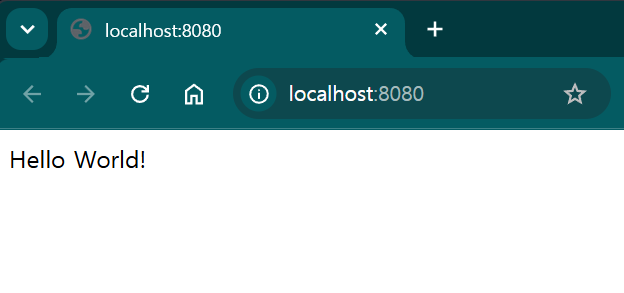
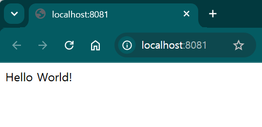
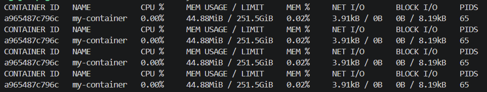

# E1-1. Dev Setup

## 1) Environment

| 항목 | 버전 |
| --- | --- |
| OS | Ubuntu 20.04.6 LTS |
| Shell | Bash 5.0.17(1)-release |
| Docker | 23.0.3 |
| Git | 2.25.1 |

## 2) Checklist

- [X] (1) Terminal & Folder - Basic terminal operations and folder setup
- [X] (2) Permission - Practice changing file permissions
- [X] (3) Docker Installation - Install and verify Docker
- [X] (4) Docker Build / Execution - Build and run a Docker image using a Dockerfile
- [X] (5) "hello-world" Execution - 전용 이미지 실행 및 정상 종료 확인
- [X] (6) Port Mapping & Access - Access containers through port mapping (2 times)
- [X] (7) Bind Mount - 호스트 ↔ 컨테이너 양방향 변경 결과
- [X] (8) Volume - Verify Docker volume persistence
- [X] (9) Git & VSCode Github - Configure Git and connect VS Code to GitHub

### 저장소 구조

```text
Dev_Setup/
├── README.md                    실습 절차, 실행 기록, 결과 판독 기준
├── images/                      Docker 실습에서 촬영한 화면
│   ├── docker-images.png        빌드한 이미지의 태그·ID·크기
│   ├── docker-containers.png    실행 중인 웹 컨테이너와 포트 매핑
│   ├── docker-web.png           브라우저 접속 결과 (8080)
│   ├── docker-web2.png          브라우저 접속 결과 (8081)
│   └── docker-stats.png         컨테이너 자원 사용량
└── evidence/
    ├── terminal-session.txt     파일·권한 실습과 Git 진단을 재실행한 Bash 원본 로그
    └── host-checks.txt          호스트 TCP 포트 충돌과 파일 백업·복구 원본 로그
```

빌드 재현 시 `Dockerfile`과 `site/index.html`은 별도의 임시 디렉토리에 생성한다.

## 3) Details

- [0. Version Check](#step-0)
- [1. Terminal & Folder](#step-1)
- [2. Permission](#step-2)
- [3. Docker Installation](#step-3)
- [4. Docker Build / Execution](#step-4)
- [5. "hello-world" Execution](#step-5)
- [6. Port Mapping & Access](#step-6)
- [7. Bind Mount](#step-7)
- [8. Volume](#step-8)
- [9. Git & VSCode Github](#step-9)
- [Docker 실습 재현 및 증거 수집](#docker-replay)
- [트러블슈팅 — 포트 충돌 및 Git 작업 위치](#troubleshooting)
- [보너스 과제 — Docker Compose와 GitHub SSH](#bonus)

<a id="step-0"></a>

### (0) Version Check

- Ubuntu Terminal에서 아래 Bash Command로 환경 정보를 확인

| 항목 | 명령어 | 출력 내용 | 출력 예시 |
| --- | --- | --- | --- |
| OS | `cat /etc/os-release` | 운영체제 정보 (`PRETTY_NAME`에서 Ubuntu 버전 확인) | `PRETTY_NAME="Ubuntu 20.04.6 LTS"` |
| 현재 Shell | `ps -p $$ -o comm=` | 현재 실행 중인 Shell 이름 | `bash` |
| Bash 버전 | `echo "$BASH_VERSION"` | 현재 Bash의 버전 문자열 | `5.0.17(1)-release` |
| Docker CLI 버전 | `docker --version` | Docker 클라이언트 버전과 빌드 정보 | `Docker version 23.0.3, build 3e7cbfd` |
| Git 버전 | `git --version` | 설치된 Git 버전 | `git version 2.25.1` |

#### OS - Check Ubuntu Version

- **설명**

    - `cat /etc/os-release`는 운영체제 정보 파일의 내용을 출력
    - `PRETTY_NAME`에서 Ubuntu 버전 확인
    - `ID_LIKE`는 현재 배포판과 계열이 비슷하거나 기반이 되는 배포판의 ID를 나타냄

- **명령어**

    ```bash
    cat /etc/os-release
    ```

- **실행 결과**

    ```text
    NAME="Ubuntu"
    VERSION="20.04.6 LTS (Focal Fossa)"
    ID=ubuntu
    ID_LIKE=debian
    PRETTY_NAME="Ubuntu 20.04.6 LTS"
    VERSION_ID="20.04"
    HOME_URL="https://www.ubuntu.com/"
    SUPPORT_URL="https://help.ubuntu.com/"
    BUG_REPORT_URL="https://bugs.launchpad.net/ubuntu/"
    PRIVACY_POLICY_URL="https://www.ubuntu.com/legal/terms-and-policies/privacy-policy"
    VERSION_CODENAME=focal
    UBUNTU_CODENAME=focal
    ```

#### Shell - Check Current Shell

- **설명**

    - `ps -p $$ -o comm=`는 현재 셸 프로세스의 명령 이름 출력
    - `$$`는 현재 셸의 프로세스 ID, `-p`는 조회할 프로세스 선택, `-o comm=`는 열 제목 없이 명령 이름만 출력하는 옵션
    - `bash`가 출력되면 현재 셸이 Bash임을 의미
    - `Bash(Bourne Again SHell)` : UNIX 계열 OS를 위해 개발된 상호작용형 CLI(Command Line Interface)이자 Script Language 

- **명령어**

    ```bash
    ps -p $$ -o comm=
    ```

- **실행 결과**

    ```text
    bash
    ```

#### Bash - Check Bash Version

- **설명**

    - `echo "$BASH_VERSION"`은 현재 Bash의 버전 문자열을 출력
    - `5.0.17(1)-release`는 **Bash의 버전**이므로 환경 정보에는 `Bash 5.0.17(1)-release`처럼 셸 이름과 함께 작성
    - Bash 이외의 셸에서는 이 변수가 설정되지 않아 빈 값이 출력될 수 있음

- **명령어**

    ```bash
    echo "$BASH_VERSION"
    ```

- **실행 결과**

    ```text
    5.0.17(1)-release
    ```

#### Docker - Check CLI Version

- **설명**

    - `docker --version`은 설치된 **Docker CLI(클라이언트)의 버전과 빌드 정보**를 출력
    - 아래 결과에서 버전은 `23.0.3`, 빌드는 `3e7cbfd`

- **명령어**

    ```bash
    docker --version
    ```

- **실행 결과**

    ```text
    Docker version 23.0.3, build 3e7cbfd
    ```

#### Docker - Check Engine Connection

- **설명**

    - `docker version`은 Docker 클라이언트와 서버(엔진)의 버전 정보를 확인
    - 엔진이 실행 중이고 현재 CLI에서 정상적으로 연결되면 `Client`와 `Server` 정보가 모두 출력됨
        - `Client`: Docker CLI의 버전 및 관련 정보
        - `Server`: 연결된 Docker 엔진의 버전 및 관련 정보
    - 엔진에 연결할 수 없으면 서버 정보를 얻지 못하고 연결 오류가 표시될 수 있음

- **명령어**

    ```bash
    docker version
    ```

- **실행 결과**

    ```bash
    Client: Docker Engine - Community
     Version:           23.0.3
     API version:       1.42
     Go version:        go1.19.7
     Git commit:        3e7cbfd
     Built:             Tue Apr  4 22:06:10 2023
     OS/Arch:           linux/amd64
     Context:           default

    Server: Docker Engine - Community
     Engine:
      Version:          23.0.3
      API version:      1.42 (minimum version 1.12)
      Go version:       go1.19.7
      Git commit:       59118bf
      Built:            Tue Apr  4 22:06:10 2023
      OS/Arch:          linux/amd64
      Experimental:     false
     containerd:
      Version:          1.6.20
      GitCommit:        2806fc1057397dbaeefbea0e4e17bddfbd388f38
     runc:
      Version:          1.1.5
      GitCommit:        v1.1.5-0-gf19387a
     docker-init:
      Version:          0.19.0
      GitCommit:        de40ad0
    ```

#### Git - Check Git Version

- **설명**

    - `git --version`은 설치된 Git의 버전을 출력
    - 아래 결과의 `2.25.1`이 Git 버전

- **명령어**

    ```bash
    git --version
    ```

- **실행 결과**

    ```text
    git version 2.25.1
    ```

<a id="step-1"></a>

### (1) Terminal & Folder - Basic terminal operations and folder setup

**재실행 결과 (2026-11-21)** · 임시 디렉토리에서 파일 생성·복사·이동·이름 변경과 권한 변경을 확인했다. [Bash 세션 원본 로그](./evidence/terminal-session.txt)

<details>
<summary>파일 권한·Git·Docker 환경 확인 로그 전체 보기</summary>

```text
# 터미널과 권한 실습 재현
date -Is
2026-11-21T19:19:31+09:00
pwd
/tmp/dev-setup-terminal-v5vx3odp
umask 022
touch hello_world.txt
ls -la
total 220
drwx------ 2 root root   4096 Nov 21 19:19 .
drwxrwxrwt 1 root root 217088 Nov 21 19:19 ..
-rw-r--r-- 1 root root      0 Nov 21 19:19 hello_world.txt
printf 'Hello World!\n' > hello_world.txt
cat hello_world.txt
Hello World!
mkdir dev_setup
cd dev_setup
pwd
/tmp/dev-setup-terminal-v5vx3odp/dev_setup
cd ..
cp hello_world.txt hello_world_cp.txt
mv hello_world_cp.txt dev_setup/
cd dev_setup
mv hello_world_cp.txt renamed_hello_world.txt
ls -l renamed_hello_world.txt
-rw-r--r-- 1 root root 13 Nov 21 19:19 renamed_hello_world.txt
chmod 755 renamed_hello_world.txt
ls -l renamed_hello_world.txt
-rwxr-xr-x 1 root root 13 Nov 21 19:19 renamed_hello_world.txt
cd ..
chmod 644 dev_setup
ls -ld dev_setup
drw-r--r-- 2 root root 4096 Nov 21 19:19 dev_setup
chmod 755 dev_setup
ls -ld dev_setup
drwxr-xr-x 2 root root 4096 Nov 21 19:19 dev_setup

# Git 작업 위치 오류와 복구, 현재 저장소의 push 기록
cd /root
pwd
/root
git rev-parse --show-toplevel || true
fatal: not a git repository (or any parent up to mount point /)
Stopping at filesystem boundary (GIT_DISCOVERY_ACROSS_FILESYSTEM not set).
cd /root/Dev_Setup
git rev-parse --show-toplevel
/root/Dev_Setup
git remote get-url origin
https://github.com/eunhye0323/Dev_Setup.git
git branch -vv
* master 7a2e4f3 [origin/master] update dev setup
git log -1 --date=iso-local --format='%h %cd %s'
7a2e4f3 2026-11-21 19:04:12 +0900 update dev setup
git reflog show -1 --date=iso-local --format='%h %gd %gs' refs/remotes/origin/master
7a2e4f3 origin/master@{2026-11-21 19:04:18 +0900} update by push
git rev-parse HEAD
7a2e4f34cc2d68774b5fca1a22e65bc994d1761f
git ls-remote origin refs/heads/master
7a2e4f34cc2d68774b5fca1a22e65bc994d1761f	refs/heads/master

# 편집 환경에서 Docker 실행 가능 여부 확인
ps -p 1 -o comm=
bash
docker version || true
bash: line 41: docker: command not found
ls -l /var/run/docker.sock || true
ls: cannot access '/var/run/docker.sock': No such file or directory
systemctl is-active docker.service || true
System has not been booted with systemd as init system (PID 1). Can't operate.
Failed to connect to bus: Host is down
```

</details>

#### pwd - Check Current Directory

- **설명**

    - 현재 작업 중인 디렉토리의 절대경로를 출력하는 명령어

- **명령어**

    ```bash
    pwd
    ```

- **실행 결과**

    ```text
    /root/Dev_Setup
    ```

#### touch - Create Empty File

- **설명**

    - 내용이 없는 빈 파일을 생성하고, `ls -la`로 파일이 정상적으로 만들어졌는지 확인

- **명령어**

    ```bash
    touch hello_world.txt
    ls -la
    ```

- **실행 결과**

    ```text
    total 36
    drwxr-xr-x  4 root root  4096 Nov  9 06:35 .
    drwxrwxr-x 64 1001 1001 12288 Nov  9 06:33 ..
    drwxr-xr-x  8 root root  4096 Nov  9 06:33 .git
    -rw-r--r--  1 root root 10985 Nov  9 06:28 README.md
    -rw-r--r--  1 root root     0 Nov  9 06:35 hello_world.txt
    drwxr-xr-x  2 root root  4096 Nov  9 06:28 images
    ```

#### nano - Write and Verify File Content

- **설명**

    - 터미널 에디터 nano로 텍스트를 작성/저장하고, `cat`으로 저장된 내용을 확인

- **명령어**

    ```bash
    nano hello_world.txt
    cat hello_world.txt
    ```

- **실행 결과**

    ```text
    Hello World!
    ```

#### mkdir - Create Directory

- **설명**

    - 새 디렉토리를 생성하고, `ls -la`로 폴더가 추가되었는지 확인

- **명령어**

    ```bash
    mkdir dev_setup
    ls -la
    ```

- **실행 결과**

    ```text
    total 44
    drwxr-xr-x  5 root root  4096 Nov  9 06:35 .
    drwxrwxr-x 64 1001 1001 12288 Nov  9 06:33 ..
    drwxr-xr-x  8 root root  4096 Nov  9 06:33 .git
    -rw-r--r--  1 root root 10985 Nov  9 06:28 README.md
    drwxr-xr-x  2 root root  4096 Nov  9 06:35 dev_setup
    -rw-r--r--  1 root root    13 Nov  9 06:35 hello_world.txt
    drwxr-xr-x  2 root root  4096 Nov  9 06:28 images
    ```

#### cd - Change Directory

- **설명**

    - 생성한 디렉토리로 이동하고, `pwd`로 현재 경로가 바뀌었는지 확인

- **명령어**

    ```bash
    cd dev_setup
    pwd
    ```

- **실행 결과**

    ```text
    /root/dev_setup/dev_setup
    ```

#### cp - Copy File

- **설명**

    - 기존 파일을 복사해 새 파일을 만들고, `ls -la`로 원본과 복사본이 함께 존재하는지 확인

- **명령어**

    ```bash
    cd ..
    cp hello_world.txt hello_world_cp.txt
    ls -la
    ```

- **실행 결과**

    ```text
    total 48
    drwxr-xr-x  5 root root  4096 Nov  9 06:35 .
    drwxrwxr-x 64 1001 1001 12288 Nov  9 06:33 ..
    drwxr-xr-x  8 root root  4096 Nov  9 06:33 .git
    -rw-r--r--  1 root root 10985 Nov  9 06:28 README.md
    drwxr-xr-x  2 root root  4096 Nov  9 06:35 dev_setup
    -rw-r--r--  1 root root    13 Nov  9 06:35 hello_world.txt
    -rw-r--r--  1 root root    13 Nov  9 06:35 hello_world_cp.txt
    drwxr-xr-x  2 root root  4096 Nov  9 06:28 images
    ```

#### mv - Move File

- **설명**

    - `mv`로 파일을 다른 디렉토리로 옮기고, 이동한 위치에서 `ls -la`로 확인

- **명령어**

    ```bash
    mv ./hello_world_cp.txt ./dev_setup/hello_world_cp.txt
    cd dev_setup
    ls -la
    ```

- **실행 결과**

    ```text
    total 12
    drwxr-xr-x 2 root root 4096 Nov  9 06:35 .
    drwxr-xr-x 5 root root 4096 Nov  9 06:35 ..
    -rw-r--r-- 1 root root   13 Nov  9 06:35 hello_world_cp.txt
    ```

#### mv - Rename File

- **설명**

    - 같은 디렉토리 내에서 `mv`를 사용하면 이동이 아닌 이름 변경으로 동작함을 확인

- **명령어**

    ```bash
    mv hello_world_cp.txt renamed_hello_world.txt
    ls -la
    ```

- **실행 결과**

    ```text
    total 12
    drwxr-xr-x 2 root root 4096 Nov  9 06:35 .
    drwxr-xr-x 5 root root 4096 Nov  9 06:35 ..
    -rw-r--r-- 1 root root   13 Nov  9 06:35 renamed_hello_world.txt
    ```

<a id="step-2"></a>

### (2) Permission - Practice changing file permissions

#### chmod - Change File Permission

| 숫자 | 계산 | 표기 | 뜻 |
| --- | --- | --- | --- |
| 0 | 0 | `---` | 아무 권한 없음 |
| 1 | 1 | `--x` | 실행만 |
| 2 | 2 | `-w-` | 쓰기만 |
| 3 | 2+1 | `-wx` | 쓰기+실행 |
| 4 | 4 | `r--` | 읽기만 |
| 5 | 4+1 | `r-x` | 읽기+실행 |
| 6 | 4+2 | `rw-` | 읽기+쓰기 |
| 7 | 4+2+1 | `rwx` | 전부 |

**권한이 적용되는 대상**

`chmod`의 세 자리 숫자는 왼쪽부터 User, Group, Others의 권한을 나타냄

| 대상 | 기호 | 권한이 적용되는 사용자 |
| --- | --- | --- |
| User (소유자) | `u` | 파일이나 디렉토리의 소유자 |
| Group (그룹) | `g` | 소유자를 제외한 사용자 중 파일이나 디렉토리의 소유 그룹에 속한 사용자 |
| Others (기타 사용자) | `o` | 소유자도 아니고 소유 그룹에도 속하지 않은 사용자 |

**`ls -l` 권한 필드 해석**

| 파일 유형 | 소유자 | 그룹 | 기타 사용자 |
| --- | --- | --- | --- |
| `-` 일반 파일 | `rwx` (7) | `r-x` (5) | `r-x` (5) |

- **설명**

    - `chmod 755`로 파일에 실행 권한을 부여하고, 변경 전후 `ls -la` 권한 필드를 비교
    - `755`는 모두에게 실행 권한을 주고 쓰기는 소유자에게만 허용한다. 여기서는 텍스트 파일의 실행 비트 변화를 관찰한다.

- **명령어**

    ```bash
    ls -la
    chmod 755 renamed_hello_world.txt
    ls -la
    ```

- **실행 결과**

    `ls -la`

    ```text
    total 12
    drwxr-xr-x 2 root root 4096 Nov  9 06:35 .
    drwxr-xr-x 5 root root 4096 Nov  9 06:35 ..
    -rw-r--r-- 1 root root   13 Nov  9 06:35 renamed_hello_world.txt
    ```

    `ls -la`

    ```text
    total 12
    drwxr-xr-x 2 root root 4096 Nov  9 06:35 .
    drwxr-xr-x 5 root root 4096 Nov  9 06:35 ..
    -rwxr-xr-x 1 root root   13 Nov  9 06:35 renamed_hello_world.txt
    ```

**용도별 권한 예시** · 각 자리의 값은 `r=4`, `w=2`, `x=1`의 합이다.

| 대상 | 권한 예시 | 선택 이유 |
| --- | --- | --- |
| 일반 문서 | `644` (`rw-r--r--`) | 소유자가 편집하고 다른 사용자는 읽는다. |
| 공유할 디렉토리 | `755` (`rwxr-xr-x`) | 다른 사용자도 목록을 보고(`r`) 경로를 통과할 수 있다(`x`). 항목을 만들거나 삭제하는 권한은 소유자에게 둔다. |
| 직접 실행할 스크립트 | `755` (`rwxr-xr-x`) | 다른 사용자도 스크립트를 읽고 실행할 수 있다. 소유자만 실행할 스크립트에는 `700`을 쓴다. |

#### chmod - Change Directory Permission

- **설명**

    - 디렉토리의 `x`는 진입과 하위 경로 탐색 권한이다. root 세션에서 `chmod 644` 전후의 권한 비트를 비교한다.

- **명령어**

    ```bash
    cd ..
    ls -la
    chmod 644 dev_setup
    ls -la
    ```

- **실행 결과**

    `ls -la`

    ```text
    total 44
    drwxr-xr-x  5 root root  4096 Nov  9 06:35 .
    drwxrwxr-x 64 1001 1001 12288 Nov  9 06:33 ..
    drwxr-xr-x  8 root root  4096 Nov  9 06:33 .git
    -rw-r--r--  1 root root 10985 Nov  9 06:28 README.md
    drwxr-xr-x  2 root root  4096 Nov  9 06:35 dev_setup
    -rw-r--r--  1 root root    13 Nov  9 06:35 hello_world.txt
    drwxr-xr-x  2 root root  4096 Nov  9 06:28 images
    ```

    `ls -la`

    ```text
    total 44
    drwxr-xr-x  5 root root  4096 Nov  9 06:35 .
    drwxrwxr-x 64 1001 1001 12288 Nov  9 06:33 ..
    drwxr-xr-x  8 root root  4096 Nov  9 06:33 .git
    -rw-r--r--  1 root root 10985 Nov  9 06:28 README.md
    drw-r--r--  2 root root  4096 Nov  9 06:35 dev_setup
    -rw-r--r--  1 root root    13 Nov  9 06:35 hello_world.txt
    drwxr-xr-x  2 root root  4096 Nov  9 06:28 images
    ```

<a id="step-3"></a>

### (3) Docker Installation - Install and verify Docker

#### docker --version - Verify Installation

- **설명**

    - 설치된 Docker 클라이언트 버전을 출력해 정상 설치 여부를 확인

- **명령어**

    ```bash
    docker --version
    ```

- **실행 결과**

    ```text
    Docker version 23.0.3, build 3e7cbfd
    ```

#### docker info - Check Detailed Info

- **설명**

    - Docker 데몬의 상세 설정(스토리지 드라이버, 실행 중인 컨테이너/이미지 수, 런타임 등)을 확인

- **명령어**

    ```bash
    docker info
    ```

- **실행 결과**

    ```text
    Client:
     Context:    default
     Debug Mode: false
     Plugins:
      buildx: Docker Buildx (Docker Inc.)
        Version:  v0.10.4
        Path:     /usr/libexec/docker/cli-plugins/docker-buildx
      compose: Docker Compose (Docker Inc.)
        Version:  v2.17.2
        Path:     /usr/libexec/docker/cli-plugins/docker-compose

    Server:
     Containers: 73
      Running: 2
      Paused: 0
      Stopped: 71
     Images: 120
     Server Version: 23.0.3
     Storage Driver: overlay2
      Backing Filesystem: extfs
      Supports d_type: true
      Using metacopy: false
      Native Overlay Diff: true
      userxattr: false
     Logging Driver: json-file
     Cgroup Driver: cgroupfs
     Cgroup Version: 1
     Plugins:
      Volume: local
      Network: bridge host ipvlan macvlan null overlay
      Log: awslogs fluentd gcplogs gelf journald json-file local logentries splunk syslog
     Swarm: inactive
     Runtimes: io.containerd.runc.v2 nvidia runc
     Default Runtime: runc
     Init Binary: docker-init
     containerd version: 2806fc1057397dbaeefbea0e4e17bddfbd388f38
     runc version: v1.1.5-0-gf19387a
     init version: de40ad0
     Security Options:
      apparmor
      seccomp
       Profile: builtin
     Kernel Version: 5.15.0-139-generic
     Operating System: Ubuntu 20.04.6 LTS
     OSType: linux
     Architecture: x86_64
     CPUs: 64
     Total Memory: 251.5GiB
     Name: deepcgv-mk3
     ID: XO3U:27VL:HJ4B:2DJW:RWT6:FJHH:7THB:2FTM:KFSB:5GNH:K42Q:QCY6
     Docker Root Dir: /var/lib/docker
     Debug Mode: false
     Username: zinic2
     Registry: https://index.docker.io/v1/
     Experimental: false
     Insecure Registries:
      127.0.0.0/8
     Live Restore Enabled: false
    ```

#### Docker 데몬 상태

**설명**

- `docker info`로 엔진 응답을 확인한다. 당시 서버 버전은 `23.0.3`, 실행 중인 컨테이너는 2개였다.
- 서비스 상태는 `systemctl status docker.service`의 `Active:` 행에서, 시작·실패 기록은 `journalctl -u docker.service`에서 확인한다. [데몬 상태 수집 명령](#docker-replay)

**환경별 실행 결과**

| 환경 | PID 1 | 확인한 내용 |
| --- | --- | --- |
| 편집 환경 (2026-11-21) | `bash` | Docker CLI와 `/var/run/docker.sock` 없음. [환경 확인 로그](./evidence/terminal-session.txt) |
| 실습 호스트 `deepcgv-mk3` | `systemd` | 아래 명령으로 PID 1 확인 |

**호스트 확인 기록**

```console
$ ps -p 1 -o comm=
systemd
```

<a id="step-4"></a>

### (4) Docker Build / Execution - Build and run a Docker image using a Dockerfile

**이미지와 컨테이너**

| 작업 | 명령어 | 결과 |
| --- | --- | --- |
| 이미지 빌드 | `docker build` | Dockerfile과 빌드 디렉토리의 파일로 읽기 전용 이미지 `my-web:1.0`을 만든다. |
| 컨테이너 실행 | `docker run` | 하나의 이미지에서 독립된 프로세스와 쓰기 계층을 가진 컨테이너를 여러 개 생성할 수 있다. |
| 중지·재시작 | `docker stop` / `docker start` | 컨테이너의 쓰기 계층이 유지된다. |
| 컨테이너 삭제 | `docker rm` | 쓰기 계층은 삭제되고 이미지와 이름 있는 볼륨은 남는다. |

#### nginx

- **설명**

    - 정적 파일 서빙, 리버스 프록시 등에 널리 쓰이는 경량 웹 서버
    - 여기서는 `nginx:alpine` 이미지를 베이스로 정적 페이지(`site/`)를 서빙하는 커스텀 이미지를 만드는 데 사용

#### Dockerfile

- **설명**

    - nginx 베이스 이미지에 정적 페이지(`site/`)를 담아 이미지를 정의하는 Dockerfile

- **파일 내용**

    ```dockerfile
    FROM nginx:alpine
    LABEL org.opencontainers.image.title="my-custom-nginx"
    ENV APP_ENV=dev
    COPY site/ /usr/share/nginx/html/
    ```

#### docker image build

- **설명**

    - 정적 페이지 파일을 준비하고, 위 Dockerfile을 기반으로 `my-web:1.0` 이미지를 빌드

- **명령어**

    ```bash
    mkdir site
    echo "Hello World!" > site/index.html
    docker build -t my-web:1.0 .
    ```

**실행 결과** · 빌드한 태그와 ID는 아래 `docker images`에서 확인 [단계별 빌드 로그 수집](#docker-build-replay)

#### docker images

- **명령어**

    ```bash
    docker images
    ```

- **실행 결과**

    ```text
    REPOSITORY   TAG   IMAGE ID       CREATED       SIZE
    my-web       1.0   a0311a9bdaae   3 hours ago   62.4MB
    ```

- **전사한 원본 화면** (캡처에 보이는 한 행)

    

<a id="step-5"></a>

### (5) "hello-world" Execution - Run the hello-world container

**설명** · `hello-world`는 필요하면 이미지를 내려받고 메시지를 출력한 뒤 종료한다.

**명령어**

```bash
docker run hello-world
```

**실행 결과** · `deepcgv-mk3`에서 다음 메시지가 출력되었고 컨테이너는 종료 코드 `0`으로 실행을 마쳤다.

```text
Hello from Docker!
This message shows that your installation appears to be working correctly.

To generate this message, Docker took the following steps:
 1. The Docker client contacted the Docker daemon.
 2. The Docker daemon pulled the "hello-world" image from the Docker Hub.
    (amd64)
 3. The Docker daemon created a new container from that image which runs the
    executable that produces the output you are currently reading.
 4. The Docker daemon streamed that output to the Docker client, which sent it
    to your terminal.

To try something more ambitious, you can run an Ubuntu container with:
 $ docker run -it ubuntu bash

Share images, automate workflows, and more with a free Docker ID:
 https://hub.docker.com/

For more examples and ideas, visit:
 https://docs.docker.com/get-started/
```

<a id="step-6"></a>

### (6) Port Mapping & Access - Access containers through port mapping (2 times)

**설명**

- 기본 브리지에서는 컨테이너마다 인터페이스·라우팅 테이블·포트 공간이 분리된다. 두 nginx 모두 내부 포트 `80/tcp`를 사용할 수 있다.
- `-p 호스트포트:컨테이너포트`는 호스트 요청을 해당 컨테이너로 전달한다. 아래 두 컨테이너는 각각 `8080:80`과 `8081:80`을 사용한다. [Docker 포트 게시 문서](https://docs.docker.com/engine/network/port-publishing/)

#### docker container run

- **설명**

    - 같은 이미지로 컨테이너 2개를 생성하되, 호스트 포트를 각각 8080/8081로 다르게 매핑하여 동시 실행

- **명령어**

    ```bash
    docker run -d -p 8080:80 --name my-container my-web:1.0
    docker run -d -p 8081:80 --name my-container2 my-web:1.0
    ```

- **실행 결과**

    `docker run -d -p 8080:80 --name my-container my-web:1.0`

    ```text
    a965487c796cc8614f70aee1c92b03c15ebaf7529471801152118aada2b8ef89
    ```

    `docker run -d -p 8081:80 --name my-container2 my-web:1.0`

    ```text
    410faac2f186091ad11660983fc2e5bd977a20355e2d47c0e253fe8a94e7764a
    ```

#### docker ps (process status)

- **설명**

    - 현재 실행 중인 컨테이너 목록과 포트 매핑 상태를 확인
    - `docker ps`: 실행 중인(running) 컨테이너만 표시
    - `docker ps -a`: 중지된(stopped) 컨테이너까지 전부 표시 (`-a`: all)

- **명령어**

    ```bash
    docker ps
    ```

- **실행 결과**

    

**실행 중인 웹 컨테이너** (위 캡처에서 발췌)

| 컨테이너 ID | 이름 | 호스트 IPv4 포트 → 컨테이너 포트 |
| --- | --- | --- |
| `a965487c796c` | `my-container` | `0.0.0.0:8080 → 80/tcp` |
| `410faac2f186` | `my-container2` | `0.0.0.0:8081 → 80/tcp` |

#### docker ps -a · 웹 컨테이너 종료 상태

**명령어**

```bash
docker ps -a
```

**실행 결과** · `deepcgv-mk3`에서 이후 조회한 목록 중 `my-web:1.0` 두 행을 발췌했다. 두 컨테이너 모두 정상 종료했다.

```text
CONTAINER ID   IMAGE        COMMAND                  CREATED        STATUS                  PORTS     NAMES
a965487c796c   my-web:1.0   "/docker-entrypoint.…"   3 months ago   Exited (0) 3 months ago           my-container
410faac2f186   my-web:1.0   "/docker-entrypoint.…"   3 months ago   Exited (0) 3 months ago           my-container2
```

#### Browser Access

- **설명**

    - 두 컨테이너가 각자 매핑된 포트로 정상 응답하는지 브라우저로 접속하여 확인

- **실행 결과**

    | port 8080 | port 8081 |
    |---|---|
    |  |  |

#### curl

- **설명**

    - 브라우저 대신 `curl`로 각 포트에 HTTP 요청을 보내 응답 내용을 확인

- **명령어**

    ```bash
    curl localhost:8080
    curl http://localhost:8081
    ```

- **실행 결과**

    `curl localhost:8080`

    ```text
    Hello World!
    ```

    `curl http://localhost:8081`

    ```text
    Hello World!
    ```

**HTTP 헤더 확인** · 각 포트에 `curl -I`로 요청해 상태 코드 `200`과 `Content-Type`을 확인한다. [포트별 헤더 수집 명령](#docker-ports-replay)

#### docker logs

- **특정 컨테이너의 nginx 요청 로그 확인**

    ```bash
    docker logs my-container
    docker logs my-container2
    ```

#### docker stats

- **명령어**

    ```bash
    docker stats
    ```

- **실행 결과**

    

<a id="step-7"></a>

### (7) Bind Mount - Verify bind mount synchronization

**설명**

- `src`는 Docker 데몬 호스트의 경로, `dst`는 컨테이너 안의 절대경로다. 예를 들어 `"$build_dir/site"`를 nginx의 `/usr/share/nginx/html`에 연결할 수 있다.
- 상대경로 `./site`는 작업 디렉토리에 따라 달라진다. 실습에서는 `mktemp`로 만든 절대경로를 `src`로 사용한다. [Docker 바인드 마운트 문서](https://docs.docker.com/engine/storage/bind-mounts/)

#### 양방향 변경 확인 (`deepcgv-mk3`)

**명령어**

```bash
(
  set -e

  bind_dir=$(mktemp -d /tmp/dev-setup-bind.XXXXXX)
  cid=$(docker run -d --rm \
    --user "$(id -u):$(id -g)" \
    --mount "type=bind,src=$bind_dir,dst=/work" \
    ubuntu sleep infinity)
  trap 'docker stop "$cid" >/dev/null' EXIT

  echo '[1] 마운트 종류와 경로'
  docker inspect --format \
    '{{range .Mounts}}{{.Type}} {{.Source}} -> {{.Destination}} rw={{.RW}}{{end}}' "$cid"

  echo '[2] 호스트에서 쓰고 컨테이너에서 읽기'
  printf 'from host\n' > "$bind_dir/hello.txt"
  docker exec "$cid" cat /work/hello.txt

  echo '[3] 컨테이너에서 덧붙이고 호스트에서 읽기'
  docker exec "$cid" sh -c 'printf "from container\n" >> /work/hello.txt'
  cat "$bind_dir/hello.txt"
)
```

**실행 결과**

```text
[1] 마운트 종류와 경로
bind /tmp/dev-setup-bind.S2yFxL -> /work rw=true
[2] 호스트에서 쓰고 컨테이너에서 읽기
from host
[3] 컨테이너에서 덧붙이고 호스트에서 읽기
from host
from container
```

| 선택 기준 | 바인드 마운트 | 이름 있는 볼륨 |
| --- | --- | --- |
| 저장 위치 | 호스트 디렉토리를 경로로 지정한다. | Docker가 관리하는 저장소를 이름으로 지정한다. |
| 적합한 용도 | 소스·정적 파일을 편집하면서 변경을 바로 확인할 때 | 컨테이너를 교체해도 앱 데이터를 다시 연결할 때 |
| 운영 시 고려할 점 | 다른 호스트에서는 경로를 맞춰야 한다. 쓰기가 필요 없으면 `readonly`로 연결한다. | 호스트 경로에 덜 의존한다. 파일 확인과 백업에는 볼륨을 마운트하는 절차가 필요하다. |

#### 호스트 경로 백업·복구

**설명** · 호스트에서 `source/`를 백업한 뒤 빈 `restored/`에 복원한다.

**명령어**

```bash
tar -C source -czf data.tar.gz .
tar -C restored -xzf data.tar.gz
sha256sum source/hello.txt restored/hello.txt
diff -r source restored
```

**실행 결과** · 두 파일의 SHA-256이 일치했고 `diff -r`에서 차이가 없었다. [명령과 해시 원본](./evidence/host-checks.txt)

<details>
<summary>포트 충돌·백업 복구 로그 전체 보기</summary>

```text
date -Is
2026-11-21T19:29:33+09:00
# 루프백의 임시 TCP 포트를 점유한 실습 프로세스로 충돌과 해제를 재현한다.
python3 -u - <<'PORT'
import errno
import socket
import subprocess
import sys

child_code = '''
import socket
with socket.socket() as listener:
    listener.bind(("127.0.0.1", 0))
    listener.listen()
    print(listener.getsockname()[1], flush=True)
    input()
'''
with subprocess.Popen([sys.executable, "-u", "-c", child_code],
                      stdin=subprocess.PIPE, stdout=subprocess.PIPE, text=True) as child:
    try:
        port = int(child.stdout.readline())
        address = ("127.0.0.1", port)
        print(f"LISTEN 127.0.0.1:{port} PID={child.pid}")
        subprocess.run(["ps", "-p", str(child.pid), "-o", "pid,comm"], check=True)
        with socket.socket() as second:
            try:
                second.bind(address)
            except OSError as error:
                if error.errno != errno.EADDRINUSE:
                    raise
                print(f"두 번째 bind 실패: {error}")
            else:
                raise RuntimeError("예상한 포트 충돌이 발생하지 않음")
    finally:
        child.communicate("\n", timeout=5)
    print(f"점유 프로세스 종료 코드: {child.returncode}")
    if child.returncode:
        raise RuntimeError("점유 프로세스 비정상 종료")

with socket.socket() as recovered:
    recovered.bind(address)
    recovered.listen()
    print(f"동일 포트 bind 및 listen 성공: 127.0.0.1:{port}")
PORT
LISTEN 127.0.0.1:45901 PID=254223
    PID COMMAND
 254223 python3
두 번째 bind 실패: [Errno 98] Address already in use
점유 프로세스 종료 코드: 0
동일 포트 bind 및 listen 성공: 127.0.0.1:45901

# 호스트 디렉토리를 빈 경로에 복원하고 파일 전체를 대조한다.
mkdir source restored
printf 'from host\n' > source/hello.txt
tar -C source -czf data.tar.gz .
tar -tzf data.tar.gz
./
./hello.txt
tar -C restored -xzf data.tar.gz
sha256sum source/hello.txt restored/hello.txt
1104b7891b40673f4b6f5cc5e09be12a68ff13567648ae1510fae709e2df7115  source/hello.txt
1104b7891b40673f4b6f5cc5e09be12a68ff13567648ae1510fae709e2df7115  restored/hello.txt
diff -r source restored
cat restored/hello.txt
from host
```

</details>

<a id="step-8"></a>

### (8) Volume - Verify Docker volume persistence

#### docker volume

- **설명**

    - 이름 있는 볼륨(`mydata`)을 생성해 컨테이너에 마운트하고 파일을 기록한 뒤, 컨테이너를 삭제하고 같은 볼륨을 새 컨테이너에 다시 마운트하여 데이터가 유지되는지 확인

- **명령어**

    ```bash
    docker volume create mydata
    docker run -d --name vol-test -v mydata:/data ubuntu sleep infinity
    docker exec -it vol-test bash -lc "echo hi > /data/hello.txt && cat /data/hello.txt"
    docker rm -f vol-test
    docker run -d --name vol-test2 -v mydata:/data ubuntu sleep infinity
    docker exec -it vol-test2 bash -lc "cat /data/hello.txt"
    docker rm -f vol-test2
    ```

- **실행 결과**

    `docker volume create mydata`

    ```text
    mydata
    ```

    `docker run -d --name vol-test -v mydata:/data ubuntu sleep infinity`

    ```text
    bc1c2bba2f0dd0040975dcf292cae58c772f22bce83a5b7b04795b2d923cd385
    ```

    `docker exec -it vol-test bash -lc "echo hi > /data/hello.txt && cat /data/hello.txt"`

    ```text
    hi
    ```

    `docker rm -f vol-test`

    ```text
    vol-test
    ```

    `docker run -d --name vol-test2 -v mydata:/data ubuntu sleep infinity`

    ```text
    0c3a49ade617c8cc2b3b07c95f4b7e23103f3906c10d9db94b80725ce3604aac
    ```

    `docker exec -it vol-test2 bash -lc "cat /data/hello.txt"`

    ```text
    hi
    ```

    `docker rm -f vol-test2`

    ```text
    vol-test2
    ```

#### 마운트 확인

```console
$ docker inspect --format '{{json .Mounts}}' vol-test3
[{"Type":"volume","Name":"mydata","Source":"/var/lib/docker/volumes/mydata/_data","Destination":"/data","Driver":"local","Mode":"z","RW":true,"Propagation":""}]
```

`vol-test3`의 `/data`에는 이름 있는 볼륨 `mydata`가 읽기·쓰기 모드로 연결되어 있다.

#### 볼륨 백업과 새 볼륨으로 복구

**설명** · 쓰기 작업이 끝난 볼륨을 읽기 전용으로 열어 호스트에 백업하고 새 빈 볼륨에 복원한다. [Docker 볼륨 백업·복구 문서](https://docs.docker.com/engine/storage/volumes/#back-up-restore-or-migrate-data-volumes)

**명령어**

원본은 `mydata`다. 같은 셸에서 [볼륨 재현 명령](#docker-volume-replay)을 실행했다면 `lab_volume`을 사용한다.

```bash
(
  set -e
  source_volume=${lab_volume:-mydata}
  docker volume inspect "$source_volume" >/dev/null
  backup_dir=$(mktemp -d "$HOME/dev-setup-backup.XXXXXX")
  archive="$backup_dir/data.tar.gz"
  docker run --rm -v "$source_volume:/data:ro" ubuntu tar -C /data -czf - . > "$archive"
  tar -tzf "$archive"

  restored_volume=$(docker volume create)
  docker run --rm -i -v "$restored_volume:/data" ubuntu tar -C /data -xzf - < "$archive"
  docker run --rm -v "$source_volume:/original:ro" -v "$restored_volume:/restored:ro" \
    ubuntu sh -ec 'diff -r /original /restored && cat /restored/hello.txt'
  printf '백업 파일 %s\n복구 볼륨 %s\n' "$archive" "$restored_volume"
)
```

**확인 기준**

- 압축 목록에 `./hello.txt`가 있고 원본과 복구본의 `diff -r` 결과가 비어 있다.
- 복구본의 `hello.txt`에서 `hi`를 읽을 수 있다.
- 호스트 디스크 장애에 대비해 검증한 압축 파일은 다른 저장장치에도 보관한다.

<a id="step-9"></a>

### (9) Git & VSCode Github - Configure Git and connect VS Code to GitHub

#### 현재 저장소의 커밋과 push 기록 (2026-11-21, 한국시간)

| 저장소 | 커밋 시각 | 로컬 reflog의 `update by push` 시각 | 실행 결과 |
| --- | --- | --- | --- |
| `/root/Dev_Setup` | 19:04:12 | 19:04:18 | 로컬 `HEAD`와 GitHub `master`의 커밋 ID 일치 |

[명령과 출력 원본](./evidence/terminal-session.txt)

```text
$ TZ=Asia/Seoul git log -1 --date=iso-local --format='%h %cd %s'
7a2e4f3 2026-11-21 19:04:12 +0900 update dev setup
$ TZ=Asia/Seoul git reflog show -1 --date=iso-local --format='%h %gd %gs' refs/remotes/origin/master
7a2e4f3 origin/master@{2026-11-21 19:04:18 +0900} update by push
$ git rev-parse HEAD
7a2e4f34cc2d68774b5fca1a22e65bc994d1761f
$ git ls-remote origin refs/heads/master
7a2e4f34cc2d68774b5fca1a22e65bc994d1761f	refs/heads/master
```

**이전 실습 기록** · 아래 세 항목은 `main` 브랜치의 `4f5470c` 시점이다.

#### git config --list - Check Git Configuration

- **설명**

    - Git에 적용된 전체 설정을 출력해 사용자 정보(`user.name`, `user.email`)가 등록되어 있는지 확인 (이메일은 일부 마스킹)
    - `credential.helper`가 VS Code의 `git-credential-helper`로 지정되어 있어, Git 인증은 VS Code에 로그인한 GitHub 계정으로 처리됨

- **명령어**

    ```bash
    git config --list
    ```

- **실행 결과**

    ```text
    credential.helper=!f() { /root/.vscode-server/bin/2c33b50b16c472efe58357d1d2a8a5414bc23fbf/node /tmp/vscode-remote-containers-c4cd4e45-8110-4af8-9854-4faba6ed526a.js git-credential-helper $*; }; f
    safe.directory=*
    user.name=eunhye0323
    user.email=vit0***@naver.com
    filter.lfs.clean=git-lfs clean -- %f
    filter.lfs.smudge=git-lfs smudge -- %f
    filter.lfs.process=git-lfs filter-process
    filter.lfs.required=true
    credential.helper=!f() { /root/.vscode-server/bin/2c33b50b16c472efe58357d1d2a8a5414bc23fbf/node /tmp/vscode-remote-containers-c4cd4e45-8110-4af8-9854-4faba6ed526a.js git-credential-helper $*; }; f
    core.repositoryformatversion=0
    core.filemode=true
    core.bare=false
    core.logallrefupdates=true
    remote.origin.url=https://github.com/eunhye0323/dev_setup.git
    remote.origin.fetch=+refs/heads/*:refs/remotes/origin/*
    branch.main.remote=origin
    branch.main.merge=refs/heads/main
    branch.main.vscode-merge-base=origin/main
    ```

#### git branch -vv - Check Branch

- **설명**

    - 현재 브랜치가 `main`이고 원격 브랜치 `origin/main`을 추적하는지 확인

- **명령어**

    ```bash
    git branch -vv
    ```

- **실행 결과**

    ```text
    * main 4f5470c [origin/main] update
    ```

#### git remote - Check GitHub Repository Link

- **설명**

    - 연결된 원격 저장소(GitHub)를 확인하고, GitHub의 `main` 최신 커밋이 로컬 `main`과 같은지 비교해 push까지 반영되었음을 확인

- **명령어**

    ```bash
    git remote -v
    git rev-parse main
    git ls-remote origin refs/heads/main
    ```

- **실행 결과**

    `git remote -v`

    ```text
    origin	https://github.com/eunhye0323/dev_setup.git (fetch)
    origin	https://github.com/eunhye0323/dev_setup.git (push)
    ```

    `git rev-parse main`

    ```text
    4f5470c2567a61893dc283980dd5038b02caed3f
    ```

    `git ls-remote origin refs/heads/main`

    ```text
    4f5470c2567a61893dc283980dd5038b02caed3f	refs/heads/main
    ```

<a id="docker-replay"></a>

## 4) Docker 실습 재현 및 증거 수집

**실행 환경**

- Docker 엔진에 연결된 Ubuntu 호스트의 저장소 루트에서 같은 Bash 세션을 사용한다.
- `log_dir`에 실행별 기록을 저장한다. `tee`는 화면과 파일에 출력을 남기고, `pipefail`은 파이프 앞 명령의 실패도 반영한다.

**명령어**

```bash
mkdir -p evidence
log_dir=$(mktemp -d "$PWD/evidence/docker-XXXXXX")
printf '실행 기록 폴더 %s\n' "$log_dir"
set -o pipefail
docker version 2>&1 | tee "$log_dir/engine.txt"
```

**확인 기준** · `docker version`에 `Server` 정보가 표시되는지 확인한다.

**서비스 상태 수집 명령어** (systemd 호스트)

```bash
systemctl status docker.service --no-pager --full 2>&1 | tee "$log_dir/daemon-status.txt"
journalctl -u docker.service -n 20 --no-pager 2>&1 | tee "$log_dir/daemon-journal.txt"
```

<a id="docker-build-replay"></a>

### 이미지 빌드와 성공 단계 기록

**명령어**

```bash
build_dir=$(mktemp -d /tmp/dev-setup-build.XXXXXX)
mkdir "$build_dir/site"
printf 'Hello World!\n' > "$build_dir/site/index.html"
cat > "$build_dir/Dockerfile" <<'DOCKERFILE'
FROM nginx:alpine
LABEL org.opencontainers.image.title="my-custom-nginx"
ENV APP_ENV=dev
COPY site/ /usr/share/nginx/html/
DOCKERFILE

DOCKER_BUILDKIT=1 docker build --progress=plain -t my-web:1.0 "$build_dir" 2>&1 | tee "$log_dir/build.txt" &&
  docker image inspect --format '{{.Id}} {{json .RepoTags}}' my-web:1.0 | tee "$log_dir/built-image.txt"
```

**확인 기준**

- `build.txt`에서 `site/` 복사와 이미지 내보내기의 완료 또는 캐시 사용을 확인한다.
- `built-image.txt`에서 이미지 ID와 태그 `my-web:1.0`을 확인한다.

<a id="docker-hello-replay"></a>

### hello-world 실행 및 전체 목록

**명령어**

```bash
docker run --cidfile "$log_dir/hello.cid" hello-world 2>&1 | tee "$log_dir/hello-world.txt" &&
  docker inspect --format '{{.Id}} {{.Config.Image}} {{.State.Status}} exit={{.State.ExitCode}}' \
    "$(cat "$log_dir/hello.cid")" | tee "$log_dir/hello-state.txt"
docker ps -a | tee "$log_dir/containers-all.txt"
docker images | tee "$log_dir/images.txt"
```

**확인 기준 및 제출 자료**

| 자료 | 확인할 내용 |
| --- | --- |
| `hello-world.png` | 실행 명령, `Hello from Docker!`, 같은 ID의 `exited exit=0`이 보이는 터미널 캡처 |
| `containers-all.txt` | `hello.cid`의 ID 앞 12자리와 일치하는 `Exited (0)` 행. 종료 후 조회를 위해 컨테이너를 보존한다. |
| `images.txt` | `docker images` 전체 출력 |

재현 시 (5)에 실행 화면을 첨부하고, README에 인용하는 컨테이너 목록은 `my-web:1.0` 행만 발췌한다.

<a id="docker-ports-replay"></a>

### 포트별 재현 — 8080과 8081

**설명** · 비어 있는 호스트 포트 `8080`과 `8081`을 `127.0.0.1`에 게시하고, 포트별 매핑·응답 헤더·본문을 저장한다.

**명령어**

```bash
(
  set -e
  for port in 8080 8081; do
    docker run --rm -d --cidfile "$log_dir/web-$port.cid" -p "127.0.0.1:$port:80" my-web:1.0
    docker port "$(cat "$log_dir/web-$port.cid")" 80/tcp | tee "$log_dir/port-$port.txt"
    curl --retry 5 --retry-connrefused --retry-delay 1 -fsSI "http://127.0.0.1:$port/" | tee "$log_dir/headers-$port.txt"
    curl -fsS "http://127.0.0.1:$port/" | tee "$log_dir/body-$port.txt"
  done
  docker ps -a | tee "$log_dir/containers-with-web.txt"
)
```

**확인 기준** · 두 포트 모두 HTTP `200`과 본문 `Hello World!`를 반환한다.

**종료 명령어** · 브라우저 확인 후 실습 컨테이너의 포트를 해제한다.

```bash
for port in 8080 8081; do
  cidfile="$log_dir/web-$port.cid"
  if [ -s "$cidfile" ]; then
    docker stop "$(cat "$cidfile")"
  fi
done
```

<a id="docker-volume-replay"></a>

### 볼륨 재현 — 컨테이너 교체 후 다시 읽기

**명령어**

```bash
lab_volume="dev-setup-${log_dir##*/}"
docker volume create "$lab_volume"
docker run --rm -v "$lab_volume:/data" ubuntu sh -c 'printf "hi\n" > /data/hello.txt'
docker run --rm -v "$lab_volume:/data:ro" ubuntu cat /data/hello.txt | tee "$log_dir/volume-read.txt"
```

**확인 기준** · 첫 컨테이너가 삭제된 뒤 새 컨테이너에서 같은 볼륨을 읽어 `hi`가 출력되면 데이터가 유지된 것이다. [바인드 마운트 실습](#step-7) · [백업 및 복구](#step-8)

<a id="troubleshooting"></a>

## 5) 트러블슈팅

### 호스트 포트 8080을 이미 사용 중일 때

**증상** · 컨테이너 실행 시 `port is already allocated` 또는 `address already in use`가 출력된다.

1. **점유자 확인** · `ss`에서 PID와 프로그램을, `docker ps`에서 호스트 쪽 포트가 `8080`인 컨테이너를 찾는다.

   ```bash
   sudo ss -ltnp 'sport = :8080'
   docker ps --format 'table {{.Names}}\t{{.Ports}}'
   ```

2. **포트 해제 또는 변경** · 본인의 실습 컨테이너라면 `docker stop my-container`, 직접 띄운 프로세스라면 해당 터미널에서 `Ctrl+C`로 종료한다. 기존 서비스를 유지하려면 대체 포트 `8082`를 사용한다.

3. **재검증** · 1단계에서 선택한 포트의 점유 상태를 확인한다(예: `sport = :8082`). 아래 명령으로 매핑과 HTTP `200` 응답을 확인한다.

   ```bash
   port=8082
   web_id=$(docker run --rm -d -p "127.0.0.1:$port:80" my-web:1.0)
   docker port "$web_id" 80/tcp
   curl --retry 5 --retry-connrefused --retry-delay 1 -fsSI "http://127.0.0.1:$port/"
   docker stop "$web_id"
   ```

**실행 결과 (호스트 TCP 실습)** · 같은 포트의 두 번째 `bind`는 실패했고, 점유 프로세스를 종료한 뒤 같은 포트에서 `listen`에 성공했다. [실제 명령과 출력](./evidence/host-checks.txt)

```text
LISTEN 127.0.0.1:45901 PID=254223
두 번째 bind 실패: [Errno 98] Address already in use
점유 프로세스 종료 코드: 0
동일 포트 bind 및 listen 성공: 127.0.0.1:45901
```

### 실제 사례 — 홈 디렉토리에서 Git 원격 설정 실패

| 단계 | 확인한 내용 |
| --- | --- |
| 증상 | `/root`에서 `git remote add origin …` 실행 시 `fatal: not a git repository`가 출력됐다. |
| 가설 | 현재 디렉토리가 프로젝트 작업 트리 밖이어서 Git이 저장소를 찾을 수 없다. |
| 검증 | 같은 위치에서 읽기 전용인 `git rev-parse --show-toplevel`을 실행해 같은 오류를 재현했다. |
| 조치와 결과 | `cd /root/Dev_Setup` 후 같은 명령이 저장소 루트를 출력했다. `git remote get-url origin`으로 기존 연결을 확인했고 로컬과 원격의 커밋 ID도 일치했다. |

```text
$ cd /root
$ git rev-parse --show-toplevel
fatal: not a git repository (or any parent up to mount point /)
Stopping at filesystem boundary (GIT_DISCOVERY_ACROSS_FILESYSTEM not set).
$ cd /root/Dev_Setup
$ git rev-parse --show-toplevel
/root/Dev_Setup
$ git remote get-url origin
https://github.com/eunhye0323/Dev_Setup.git
```

실패한 위치부터 복구 후 브랜치·원격 확인까지 한 세션에 기록했다. [실제 진단 로그](./evidence/terminal-session.txt)

<a id="bonus"></a>

## 6) 보너스 과제

과제 1~4는 Docker 호스트의 같은 Bash 세션에서 순서대로 진행한다. 과제 5는 GitHub에 push할 개인 계정의 저장소에서 진행한다. 아래 **확인 기준**은 실행 후 실제 출력과 대조할 값이다.

### 1. Docker Compose 기초 — 웹 서비스 하나 실행

**설명** · `docker-compose.yml`의 `services` 아래에 서비스 이름과 설정을 둔다. `image`는 실행할 이미지, `ports`는 호스트와 컨테이너의 포트 연결, `volumes`는 웹 페이지의 경로다. 실행 옵션을 파일로 남기면 다른 사람도 같은 설정으로 서비스를 시작할 수 있다.

**명령어** · 빈 작업 디렉토리에 페이지와 설정 파일을 만든다. `web`은 웹 서버, `probe`는 다음 과제에서 사용할 HTTP 클라이언트다.

```bash
docker compose version
lab_dir=$(mktemp -d /tmp/dev-setup-compose.XXXXXX)
cd "$lab_dir"
unset APP_PORT  # 셸에 설정된 값보다 실습의 기본값과 .env를 사용
printf 'Compose OK\n' > index.html

cat > docker-compose.yml <<'YAML'
services:
  web:
    image: python:3.12-alpine
    environment:
      APP_PORT: "${APP_PORT:-8000}"
    command: ["sh", "-c", 'exec python -m http.server "$$APP_PORT" --directory /srv']
    ports:
      - "127.0.0.1:18080:${APP_PORT:-8000}"
    volumes:
      - ./index.html:/srv/index.html:ro

  probe:
    image: busybox:1.36
    command: ["sleep", "86400"]
YAML

docker compose config
docker compose up -d web
docker compose ps
curl --retry 5 --retry-connrefused --retry-delay 1 -fsS http://127.0.0.1:18080/
```

**확인 기준** · `ps`에 `web` 하나만 실행 중이고, 호스트의 `curl` 요청에 `Compose OK`가 출력된다.

### 2. Compose 멀티 컨테이너 — 서비스 이름으로 통신

**설명** · 두 서비스는 같은 Compose 프로젝트의 기본 네트워크에 연결된다. `probe`는 Docker DNS가 제공하는 서비스 이름 `web`과 컨테이너 내부 포트 `8000`으로 접속한다. `probe` 안에서 `localhost`는 `probe` 자신을 가리킨다. [Docker Compose 네트워크 문서](https://docs.docker.com/compose/how-tos/networking/)

**명령어**

```bash
docker compose up -d
docker compose ps
docker compose exec -T probe wget -qO- http://web:8000/
```

**확인 기준** · `web`과 `probe`가 모두 실행 중이고, `probe`의 요청에서도 `Compose OK`가 출력된다. 이 요청은 호스트에 게시한 `18080` 포트를 거치지 않는다.

### 3. Compose 운영 — 실행·상태·로그·종료

| 순서 | 명령어 | 확인할 내용 |
| --- | --- | --- |
| 실행 | `docker compose up -d` | 설정에 정의한 두 서비스를 백그라운드에서 시작한다. |
| 상태 | `docker compose ps -a` | 서비스별 상태와 `web`의 포트 매핑을 확인한다. |
| 로그 | `docker compose logs --tail=20 web` | 앞서 보낸 요청에 해당하는 `GET /`와 HTTP 상태 코드 `200`을 찾는다. |
| 종료 | `docker compose down` | 이 프로젝트의 컨테이너와 기본 네트워크를 제거한다. |
| 종료 확인 | `docker compose ps -a` | 서비스 행이 남아 있지 않은지 확인한다. |

### 4. 환경 변수 — 서버의 수신 포트 변경

**설명** · 설정 파일의 `${APP_PORT:-8000}`은 Compose가 읽어 기본값 `8000`을 정한다. `environment`는 이 값을 컨테이너에 전달하고, `command`의 `$$APP_PORT`는 컨테이너 안의 셸이 읽는다. `.env` 한 줄로 서버의 수신 포트와 매핑 대상을 함께 변경한다. [Compose 환경 변수 문서](https://docs.docker.com/compose/how-tos/environment-variables/variable-interpolation/)

**명령어** · 과제 1에서 만든 임시 디렉토리에서 실행한다.

```bash
printf 'APP_PORT=8001\n' > .env
docker compose config
docker compose up -d
docker compose exec -T web printenv APP_PORT
docker compose port web 8001
curl --retry 5 --retry-connrefused --retry-delay 1 -fsS http://127.0.0.1:18080/
docker compose exec -T probe wget -qO- http://web:8001/
docker compose down
```

**확인 기준** · `printenv`는 `8001`, `docker compose port`는 `127.0.0.1:18080`을 출력한다. 호스트의 기존 주소와 `probe`의 새 내부 주소 모두에서 `Compose OK`가 반환되면 포트 변경이 적용된 것이다.

### 5. GitHub SSH 키 설정 — 등록·인증·push

**설명** · HTTPS는 토큰 등의 자격 증명으로 인증하고, SSH는 GitHub에 등록한 공개키와 로컬 개인키의 쌍으로 인증한다. 개인키는 본인 계정에 보관하고 GitHub에는 `.pub` 파일의 내용만 등록한다.

1. **키 준비** · 개인 계정의 터미널에서 공개키를 확인한다. 사용할 키 쌍이 이미 있으면 해당 공개키를 사용한다.

   ```bash
   ls -l ~/.ssh/id_ed25519.pub
   ```

   새 키가 필요한 경우 아래 명령을 실행하고 암호 문구를 설정한다. 같은 이름의 개인키가 있으면 덮어쓰지 않는다.

   ```bash
   ssh-keygen -t ed25519 -C "GitHub Dev_Setup" -f ~/.ssh/id_ed25519
   ```

2. **공개키 등록** · 아래 출력 한 줄을 GitHub의 **Settings → SSH and GPG keys → New SSH key**에서 **Authentication Key**로 등록한다. [GitHub 공개키 등록 안내](https://docs.github.com/en/authentication/connecting-to-github-with-ssh/adding-a-new-ssh-key-to-your-github-account)

   ```bash
   cat ~/.ssh/id_ed25519.pub
   ```

3. **인증 확인** · 최초 접속 시 표시되는 호스트 키 지문을 GitHub 공식 지문과 대조한다. 성공 메시지 `Hi USERNAME! You've successfully authenticated`에서 본인의 계정명을 확인한다. 이 테스트는 인증에 성공해도 종료 코드 `1`을 반환한다. [GitHub SSH 연결 테스트](https://docs.github.com/en/authentication/connecting-to-github-with-ssh/testing-your-ssh-connection) · [공식 호스트 키 지문](https://docs.github.com/en/authentication/keeping-your-account-and-data-secure/githubs-ssh-key-fingerprints)

   ```bash
   ssh -T git@github.com
   ```

4. **원격 변경 및 push** · `Dev_Setup` 저장소 루트에서 실행한다. `HEAD`를 사용하므로 현재 브랜치가 `master` 또는 `main`이어도 같은 명령을 쓴다.

   ```bash
   git remote set-url origin git@github.com:eunhye0323/Dev_Setup.git
   git remote get-url --push origin
   git push --dry-run origin HEAD
   git push -u origin HEAD
   ```

   **확인 기준** · push URL이 `git@github.com:`으로 시작하고 실제 push가 성공한다. 새 커밋이 있으면 브랜치 갱신 내역이, 이미 동기화됐으면 `Everything up-to-date`가 출력된다.

